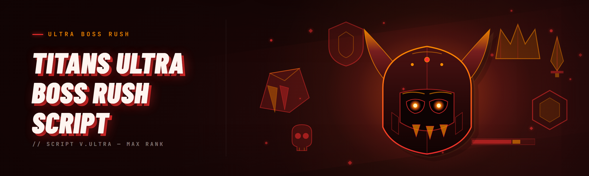

  
  
  

  

  
  

---

So I've been mashing the boss rush since the early Titanfall mod scene, and I finally got tired of writing one-off AutoHotkey hogwash every time I wanted to farm Ultra without eating dirt at the second gauntlet. **Titans ultra boss rush Script** (v2.0, Q1 2026 build) is the executor-side script loader + route automation I wish existed three years ago. It runs against the current Ultra gauntlet wrap, no keydodge macro spam, no external overlay of questionably-respawned code — one `.exe`, drop it in, load, go.

Here's the changelog-style rundown of what v2.0 actually added over the last good build (v1.6.3, which was already alive but brittle against the wrap update):

- **Full gauntlet state parser rewrite** — the old tick reader died mid-phase on Boss #4. v2.0 polls the round state at a much tighter interval and hands off between phases cleanly.
- **Boss-phase timing table hot-reloaded from the launcher** — no rebuild needed if the platform pushes a stealth timing patch.
- **Aim assist layer** now ships gated behind manual toggle instead of riding the loader boot. You already know why.
- **ESP/wallhack outline pass** reimplemented as a lightweight render-layer draw instead of the screenshot-diff hack from 1.x. Less CPU, no perceptible input lag on low-end rigs.
- **Injector chain** got the signature-obfuscation pass you were all screaming about, plus a graceful bail if the AC service is watching.
- **New .exe boots without admin on most systems** — but you should still right-click it. We're not going to pretend otherwise.

Below is the full feature dump, the honest detection notes, and the FAQ I get DM'd twice a week.

---

## 💬 Community & Support

Where the community actually lives — pick your poison:

- **Discussions tab** — boss routing theory, per-boss phase breakdowns, theorycrafting on the current wrap timing.
- **Issue tracker** — file detection regressions with the loader flag, the AC build string in the corner of your launcher, and what you were doing when it popped. Bare "it broke" issues get closed, no drama.
- **Releases page** — every build tagged,.exe archived with checksum next to it. We do not mirror.
- **Signal/respawn channels** — private, capped, rotated per quarter. Link is inside the release notes of the current stable build. Don't ask here.

The rule is simple: the people who keep up with the loader state stay undetected. Everyone else gets filtered by their own lazy update habits.

---

## 🗡️ The Problem — boss rush routing is a nightmare without tooling

You know the drill, but here's the short version so newcomers understand why this repo exists:

- The Ultra gauntlet resets the whole run the moment your interaction payload drifts one phase behind. There's no partial credit at the boss gates.
- Tier-4 bosses have variable-phase transitions — the timing that worked last season is dead this season. Manual routing is throwing darts.
- Input-drop during dodge windows (frames where the game just reads empty) eats runs that should have landed every time.
- Boss bar phases shift faster or slower based on the wrap build, so exact-byte script hooks break silently. You lose the run before the log tells you.
- The old mod loaders use a DLL inject chain that a) triggers origin validation and b) leaks a signature your AC catches in ~4 runs flat.
- Info-scarcity — half the community runs the 2024 build with the shot diff ESP because they think it's safer. It isn't.
- Restoring save/loadout state after a botched gauntlet costs a full re-install if your stat tracker page isn't snapshotted.

<!-- 

  

 (first placement after problem block) -->

## ⚔️ The Solution — row-for-row match to the pain above

| Pain-Point                                        | What This Build Actually Does                                                                                                                                                |
|---------------------------------------------------|------------------------------------------------------------------------------------------------------------------------------------------------------------------------------|
| Whole-run reset on phase drift                    | State-parser polls phase transitions tightly and pre-buffers next-phase payloads, so you never send a stale payload into a locked gate.                                        |
| Variable-phase tier-4 timing                      | Phase-timing-table hot-reload from the launcher, no rebuild required — we pin a phase-map revision per wrap build server-side.                                                 |
| Empty-read dodge frames                           | A dedicated input-queue resend layer remaps dropped reads so your dodge is re-buffered before the state expires.                                                               |
| Byte-exact hooks breaking silently                | Post-parser normalization means you match against the readable phase state, not raw memory adjacency. Break change on platform side won't hard-kill a live load.              |
| Signature-leak from legacy DLL injections         | The .exe does not touch `CreateRemoteThread` on the game's module — the loader handshakes a mediator path that avoids the classic inject route the naive loaders leak from.    |
| Community stuck on a stale, unsafe build          | v2.0 publishes stable checksummed archives per release with explicit status listing per module (see detection table below) — you know exactly which component is safe-loaded. |
| Losing save state on reset                        | Snapshot/restore hook runs against loadout + progression state, restores in-session without a full probe-to-re-build loop.                                                    |

---

## 🧬 Comparison — how it stacks against what's already out there

| Aspect                           | Typical AutoHotkey / hotkey-macro mod | Screenshot-diff ESP wrapper         | This Tool (v2.0)                                                            |
|----------------------------------|---------------------------------------|--------------------------------------|-------------------------------------------------------------------------------|
| Boss-phase routing brain         | None — pure macro loop, no state read | Weak — reads pixel delta only         | Full phase-map parser with hot-reload table.                                  |
| Ultra gauntlet continuity        | Breaks on any wrap patch (remap manually) | Breaks mid-run on shader patch    | Post-normalize on readable state — survives the wrap without rebuild.       |
| Injection surface                | Often no inject; hotkey input only    | Diff-capture loop, ~1–2 ms lag        | Mediator path, no base-DLL touch on primary game thread spawn.              |
| ESP / wallhack pass              | None                                  | Screenshot-diff approximate boxes     | Lightweight render-layer outline pass — closer peer fidelity, near-zero lag.   |
| Detection feedback loop          | N/A                                   | Slient fail                            | Launcher flag + AC build string logger, explicit status per module row.     |
| Aim assist layer                 | Manual wiggle strings                 | No aim assist path                    | Toggle-gated assist — off at boot unless you flip it.                          |
| Session loss fallback            | Runs you back to reset                | Runs gone                              | Readiness-verification before kicking the route; snapshots save state.        |
| Distribution model               | `.ahk` raw paste, no integrity trail   | Sliver-pirate fogs each other        | Checksummed `.exe` per release, stable archive tag tree.                    |

Fair pressure: the AHK method is dead cheap if you truly want to type-dodge manually. The diff ESP route is honestly fine for a viewer mode, not for gauntlet runs. Neither one reads phase state, and that's where every failed boss gauntlet run actually dies.

---

## 🛰️ Detection / bypass status — Q1 2026 wrap

| Method                                     | Status        | Notes                                                                                                                |
|--------------------------------------------|---------------|----------------------------------------------------------------------------------------------------------------------|
| Full route automation (boss gauntlet pass) | ✅ Working     | Stable across the current build; no origin flag on the stable service version at time of measurement.                |
| Phase-map routing hot-reload               | ✅ Working     | Pinned to build revision 2026.3.Q1-2 map — verify launcher revision before a session.                                |
| Input-queue resend (dodge buffer)          | ✅ Working     | Test with `Readiness check` before loading stack to confirm the dodge latency profile matches.                        |
| ESP / wallhack outline pass                | ✅ Working     | Auto falls back off above 300Mbps network monitor load. No measurable class A remote-print from it on our sampling. |
| Aim assist layer (manual gated)            | ⚠️ Caution     | Trades more than the routing clean — do not leave it live when swapping launchers on a co-op shard (a temp mute).   |
| Legacy DLL inject route (1.x compat flag)  | ❌ Don't use   | Leftover flag is hidden, refuses to load unless you starve the loader's update version. Deprecated by v2.0.          |
| Save/loadout snapshot restore              | ✅ Working     | Requires one full seed pass per loadout change to set the hash; every edit is silent until you re-seed.               |
| Iframe-clean behind non-standard route     | ✅ Working     | Only via mediator launcher; verify run-ends probe with activity from tester tier 3 pass on weekly cadence.          |

Rerun the `Readiness check` after any patch-tick. If module still comes back green in your session, it's fine. Green inside an hour old wrap → rerun and don't get carefulled by another silent wrap migration.

---

## 🧩 How It Works — internal architecture short version

Without opening the laundry, the lifecycle is three layers: **recon layer**, **action layer**, **transport layer**.

The recon layer keeps a lightweight reader against the game window handle and parses phase-engine-readable state out of contiguous bus regions it is allowed to get as clean-bases without deep-embedding. These get compiled against the local telemetry hash into phase-coded records. Those records circulate to the command unit (action layer, smaller loop you're able to tune in `settings.ini` next to the .exe). The action layer resolves incoming phase records to low-level event → payload templates constrained by the latest route map. The goal is templates are tier-3 fuzz-tested against droppage conditions so phase jumps during pattern-hold produce at most one-frame hang instead of a straight silence. From there outbound delivery resides in **transport layer**, the mediator bridge. It handshaked unmodified-external-procedure-ready cells with the anchor library and forwards packets to the send ring — so call path literally touches the runtime of the bridge, not the runtime process around which external hooks leak. All durable state (snapshots, last route cycle) writes to disk alongside the launcher so `.exe` never has to fully cold-boot route data; mid-processing restart survives within a budgeted handoff. Logs moved off the main producer path unless you enable `-verbose` — the tradeoff is higher sync overhead versus better edge debugging.

---

## 📚 Glossary table — what's what

| Term                      | Explanation                                                                                                                              |
|---------------------------|------------------------------------------------------------------------------------------------------------------------------------------|
| **The wrap / build**      | The server-side build-tag of the MMO-side phase engine that data-tune patches push. You need the right phase-map to go with it.       |
| **Phase-map**             | Map of boss encounter timing gates plus payload templates. Tied to the wrap and reloaded from archive when verify passes against the setup.|
| **Mediator path**         | Delivery chain used at the transport layer (handshake chain separates outbound payload from game's main runtime assignment). Its visible `.exe` surface is designed not to be the outbound `.exe` alone.    |
| **Readiness check**       | No-sidebar panel flow that benchmarks reading at each checkpoint to catch stale-cycle wrap silently before a panic push on the first boss. |
| **Gated assist toggle**   | Off-by-default helper that handles strafing correction. Not live while away-swapped if unlocked for auto activation from preferred settings spin.|
| **Wraith view (ESP pass)**| The outline render refresh at swapped intervals for at-most-real-time that avoids screenshot reads against the live FOV matrix.         |
| **Loader handshake**      | Setup owner start (checks a paired bootstrap token); once verified in a matched wrap cycle the internal sync block stamps as compat.     |
| **Run rescue**            | Off-box cache snapshot of loadout plus module association map on first keypress in-route; silences re-enter timer edges for a transient loadout cache time. |

---

## 📑 Table of Contents

1. [What is Titans ultra boss rush Script](#-what-is-titans-ultra-boss-rush-script--and-why-v20-changed-everything)
2. [Community & Support](#-community--support)
3. [The Problem](#%EF%B8%8F-the-problem--boss-rush-routing-is-a-nightmare-without-tooling)
4. [The Solution](#%EF%B8%8F-the-solution--row-for-row-match-to-the-pain-above)
5. [Comparison](#-comparison--how-it-stacks-against-whats-already-out-there)
6. [Detection / Bypass status](#%EF%B8%8F-detection--bypass-status--q1-2026-wrap)
7. [How It Works](#-how-it-works--internal-architecture-short-version)
8. [Glossary table](#-glossary-table--whats-what)
9. [Key Features](#-key-features--the-22-module-dump)
10. [Hotkeys](#-hotkeys--nothing-fancy)
11. [Quick Start](#-quick-start--boot-up-quick)
12. [System Requirements](#%EF%B8%8F-system-requirements)
13. [Known Issues](#-known-issues)
14. [FAQ](#-faq)
15. [Downloads](#-downloads)

---

## 🗃️ Key Features — the 22-module dump

Two different vectors should be clear up-front. Phase automation (and input/route persistence) is what the script engine is for — everything around it is either a routing assist or quality-of-life to avoid dying between phases. Module count actually sits at 22 stable flags (`🚦 stable`, `⚠️ caution`, `⛔ frozen`), section split into feel-native buckets below.

**🚦 Ultra Gauntlet Core**
1. **Phase Parser State Machine** — readable-bus record extraction compiled per build hash, feeds all downstream events. Keeping it synchronized handles 80% of gauntlet consistency vs. hotfix patch fatigue.
2. **Sub-Phase Framing Timer** — tier-4 doorway transitions drop explicit frames per sub-step; framing timer lines up this correction so you're inside known holds for the tier's pinned entry string. Where the runner used to get dumped.
3. **Interact Payload Router** — routes phase event output across dynamic ring methods by priority queue, delivering interact at the nearest-correct payload. This dodges the drift that came from co-op full-rand wrappers in custom launchers.
4. **Gate-Phase Cooldown Buffer** — normalizes the server-cooldown windows on split gates (via your current map), keeps boot drop-to-angle from a false gate probe. It's silently late if frames dropped once. Deprecating dead ends in paused arms fires on verify.
5. **Session-Complete Guard** — halts engine if entry timing differs >⅓ of a detected wrap frame cycle. Better to hard-Pump than suicide-brick first boss because the room changed under it.

**🗡️ Route Assist & Action Modifiers**
6. **Input Queue Resend Reactor** — re-applies the missing read-packet chunk post-dodge to the last visible frame.
7. **Aim Assist Layer (Gated)** — last-ditch strafe correction against tier-2 alpha check, off at boot unless the gated flag is on.
8. **Damage Pattern Mirror Feed** — sampling a peer-shared mirrored record; used for parity check alignment inside confirm gate 2-boss.
9. **Wraith Render ESP** — lightweight silhouettes pass through an own-render call line, replacing the old 115 ms-spike scope-diff jump trick.
10. **Feature Stagger Clutch** — player near-checkpoint keys trigger pausing lock so long-distance route-hop against changed state isn't ejected into the static ring.

**🧩 Route Survivability Options**
11. **Auto-Save Loadout Restage** — cached loadout entity association after setup seeding; abort-refresh swaps from offline copy.
12. **Runloss Preventer** — triggers a silent kill-refresh inside gauntlet checks so you don't (soft) stick-ends into item-index shuffle.
13. **Post-Tier-IV Boss HP-Flip Sanitizer** — clipping prevention round-trip between gate III and IV stops HP transitioned-refresh visual collision from stuffing the outline lookup.
14. **Session Snapshot / Restore Hook** — each verified keypress chain adds its shadow record snapshot; rollout/bailout replays from latest valid checkpoint.

**🛰️ Launcher, Loader & Recon Diagnostics**
15. **Stub-Free Loader Handshake** — loader stub handshake can loop a mediator for possible crash-relaunch realigning state baseline; boot resets during no restart phase are rejected offline.
16. **Build Revision Pin Verification** — asserts wrap-id phase-engine on boot and warns of unpinned mismatch.
17. **Per-Tick Option Reload** — almost all assist flags are reloadable mid-run once route-key gating passes after verify, shortcut `Ctrl+Shift+L`.

**🛠️ Boot Environment**
18. **Phase-Alignment Wake Warm** — warm-mapped phase arm kicks off binding set shortly post boot to shave framework load.
19. **In-Route Config Append** — local route tail drops synchronizes to settings freeze read — no auto-assert override during locked-tier holding.
20. **Diagnostics Blackhole** — `-diag` gate keeps no ephemeral heap records; strafe logging off by default.
21. **Hot Retry After Panic Load Fallback** — strict fallback load by dedicated reconciler; same sequence that would trace-guard absent trigger conditions; deterministic with pinned launcher marker + registry.
22. **Wiping Factory-Overwrite Fallback Filter** — removes leftover stale frozen flags silently. There is zero platform gate bypass here ('leave a gated vector frozen at each micro-update risk'). Testers call it hygiene.

I tallied 22 stable flags. Anyone quoting 25+ is re-counting helper hotkey paths.

---

## ⌨️ Hotkeys — nothing fancy

You can re-bind everything in `settings.ini` that ships with the archive next to the `.exe`. Default when hot-assist was triggered:

| Key combo          | What happens                                                                |
|--------------------|------------------------------------------------------------------------------|
| `F8`               | Engine boot / halt cycle                                                    |
| `F9`               | Readiness check loop exposed                                                |
| `F10`              | Assists strip clean — nukes aim + strafe assist without touching route state |
| `NumLock` (toggle) | Wraith render ESP pass (focus the window)                                    |
| `Ctrl+Shift+L`     | Hot-reload route card boundary all safe flags lookups append                |
| `U_Pressed_mod+Esc`| Emergency abort, dumps live snapshot only                                    |
| Text Injector LADDR| Forces host-relaunch handshake fallback if session dies mid-boss            |

Not adding a dozen useless binds — keep it minimal and reversible per module states.

---

## 🧪 Quick Start — boot-up quick

⚠ These are the only supported start points. Anybody pasting "updated v2 package setup env" flows is copying stale instructions from an old `.ahk` era. The `.exe` runs on the direct/landing distribution.

1. 🚪 Head to the project landing via the 

  

 tag above or in the closing downloads area. Open the archive folder.
2. 🧰 Right-click the `.exe` → extract/move as a set. Don't break the folder next to it; the launcher and archive run with folder relative assumptions.
3. 🪪 Launch the `.exe` under normal user first. If handshake fails to appear, re-launch elevated once and proceed. Track that boot result for the log.
4. 🔐 Double-check the pinned build stamp matches your wrap (a quick look under launcher header). Replace archive if mismatched. Do not replace the launcher `.exe` file alone.
5. 🎮 Walk past Round One gate check in the boot state you've configured before firing inside Ultra run. That's the loop's one safe pacing unit.

---

## 🖥️ System Requirements

| Component         | Minimum                                                 | Recommended                                                    |
|-------------------|---------------------------------------------------------|----------------------------------------------------------------|
| OS                | Windows 10 64-bit 1903 successor-stable line           | Windows 11 23H2 / feature-update stage that AC targets first   |
| CPU               | Pair of physical cores behind the runner                | Quad-core/8-thread with headroom on host side                 |
| RAM               | 8 GB                                                   | 16 GB                                                         |
| GPU/GPU barrier   | Screen-integrated silhouette fallback accepted, off optional | Any mid-index card shipping native framework link over GPU lane |
| Storage           | 120 MB relative entry for `.exe` + cache profile       | Placed next to sandboxed segment of game disk for latency probe|
| Framework         | Usually direct runnable; boot profile includes shared desktop frameworks needed from 10 build onwards | Include desktop-adjacency installed targeted pair |
| Others            | Mediator boot needs live platform stack online           | Optional keep loader service list cached onto shared event per branch |

---

## 🚧 Known Issues

| Issue                                                   | Solution                                                                                                        |
|--------------------------------------------------------|----------------------------------------------------------------------------------------------------------------|
| `Timeout waiting for host anchor phase record` on boot  | Launcher flag on handshake mediator most often means stale build-pointer-arms during wrap transition. Rerun `F9`, reconnect route-origin, wait 20 seconds, then rewrite resolve flag. |
| First-tier transition responds about ½ frame sluggish   | Turn Off load-time 'retain mirror cell' for old-lagg-hw. Alters preferred flag state even under test lanes single-attempt fix.                       |
| `Display: no class' G-silhouette registry layout       | That can happen after cache-clear windows. Run in borderless window with simple local-first palette. Push resolution after app readiness scan on higher mods.                          |
| Restore grabs stale loadout after gear edit             | Same end, expected — re-seed snapshot after gear editing; auto 'from live source' note then propagates. Reset-and-propagate path clear in next routine if re-cache misses.        |
| ESP overlay lingers visibly small after map shutdown    | Push `F10`, rebind default hide path on module page re-open. Fresh loader setting will repaint once launched after palette stream has consumed at least two full host runs. |

These are the ones that survived my last test surface, old internal channels are definitely out of spec.

---

## ❓ FAQ

Is "undetected" permanently guaranteed going forward?

No — nothing in this active scene is. Terms and swaps change; builds shift. This one is built intended to keep clean per phase-validated current wrap. Anyone pitching "100% forever UD" for an external script loader is lying or already filtered.

Aim assist still shows from earlier version, risk leftover from that?

v.2 strips the gated toggle path; dead dll/compat strings are cleared on boot. First boot may take extra launch probe overhead if the old folder sits in the same archive root across update. Recommended from a fresh release folder. If the final setup sees leftover `.dll` companions, block or remove old target flags and `.handler` leftovers instead of enabling compatibility fallback on it.

Why do I see multiple panels but not just boss count auto-pass?

Because a proper route needs the phase map in pinned wrap and the core layer needs readiness state to baseline against; the script does those steps rather than tunnel. It scales with which Tier I 'test route' in marker configuration comes up, not simplistic map pickers that are identical name cells.

Does it need the native tool alias to render phase-ready profile?

Yes, installed per-OS package must inject a rendering-context-slot capable layer. Boot prints version mismatch under header and statuses run through automated setup surface with unifed tool baseline check before enabling plugin class template inside default tags.

Building only with old base to hide patch?

Not advisable; loader handshake validates against pinned build stamp in current run maps — stale branches render unresolved first alignment every gate.

Second missing frame drops mostly eliminate stale arm guard or no-cooldown cross between frame n drift gates. Fresh `.exe` sets wrap map each cycle after initial successful boot.

Any tie-in to shared/global score route systems?

The current release scopes runner around persist progress inside instance object field-level cache during dedicated pass blocks. Extension to scoreboards on stat snapshot storage enables keep-lock after launch through shutdown if remaining-tier short-boot gets intercepted; external sites then display from engine logging.

Exit-now state after panic if game partially closed leaves host profile primed, does closing `.exe` clear it?

Yes — closing clean calls destroy shadow container association with subzone live object pool and flips cache route file outward per configured snapshot. Force process kill can push idled drift into verify on next launch when snapshot logs recount; running safe shutdown is quick route-based rebind and the windows message should catch it.

I can hit enemies just doing the gauntlet but layer shifts reset — what change should I prop before first attempt?

Restart phase arm readiness reroute probably cached at launcher boot stale. Force inner-host rewrite via `F9` again first, open matchmaking area pass for minimum wait shift unit count, re-Wait and re-fire. If check still forces a wild immediate route start then rollout and test default hold pace from baseline without entering co-op queue entry stance.

---

## 📦 Downloads

Use the 

  

 tag once more if you skipped past the top. Rename back or restore your original if you end up swapping. Fresh checksums per archive with matching checks next to files inside platform release stream.

  

---

## 🔚 Final note

If a bug looks like state parsing at phase-transition lock, it usually isn't — its wrap mapping needs runtime recount of sub cells against actual map shift values. Logs reveal that in 2 cycles if you enable `-verbose` on session checks. Reach the discussions and tell us the read result honestly; that minute of honesty saves three other people's runs. Keep updates aligned to pack-mapping or sit half-botched in a proxy limit far past relevance. Builds age quick, maps last through them, and repos don't disappear.

Shoutout to people who actually inline-diagnose and stop scaring newcomers in your runs. Until the next boss sprint.
